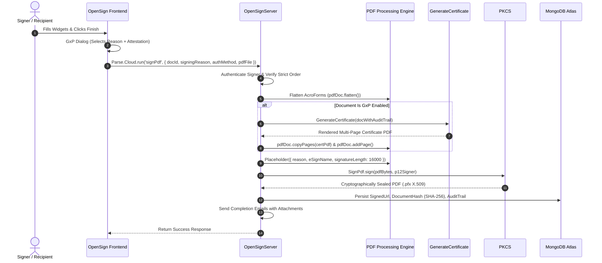

# OpenSign Platform: End-to-End Code Analysis & System Architecture Report

**Document Version:** 2.0  
**Status:** Approved / Technical Evaluation  
**Target Platform:** OpenSign Monorepo (`apps/OpenSign` & `apps/OpenSignServer`)  
**Date:** November 24, 2026  

---

## 1. Executive Summary

This report delivers a comprehensive, end-to-end technical code analysis and architectural review of the **OpenSign™** electronic signature platform. OpenSign is architected as an enterprise-grade, open-source alternative to proprietary signature solutions (such as DocuSign and Adobe Sign), offering complete self-hosting capability, multi-tenancy, digital cryptographic signing (X.509 P12/PFX), and dedicated **GxP / FDA 21 CFR Part 11 compliance modes**.

### Key Architectural Strengths
- **Dual-Tier Monorepo**: Decoupled React 18 / Vite single-page application (SPA) frontend with an Express + Parse-Server Node.js backend.
- **Cryptographic Security**: Native PKI digital signature stamping via `@signpdf/signpdf` with SHA-256 digest validation and PKCS#7 container embedding.
- **Automated Document Transformation**: Subprocess-isolated conversion of `.docx` documents to PDF using headless LibreOffice.
- **In-Memory GxP Audit Trail Stitching**: Multi-page Certificate of Completion generation embedded directly into the final PDF byte stream prior to digital signing.
- **Micro-Frontend Architecture**: Standalone guest signing modules (`microfrontends/SignDocuments`) allowing seamless integration into third-party portals.

---

## 2. Codebase Structure & Monorepo Topology

```
OpenSign/
├── apps/
│   ├── OpenSign/                   # Frontend SPA (Client Application)
│   │   ├── src/
│   │   │   ├── components/        # Reusable UI widgets & PDF canvas tools
│   │   │   │   ├── pdf/          # PDF rendering, field positioning, EditTemplate
│   │   │   │   └── sidebar/      # Navigation and organizational controls
│   │   │   ├── pages/            # Core workflow pages
│   │   │   │   ├── Form.jsx              # Document upload & compliance selection
│   │   │   │   ├── PlaceHolderSign.jsx   # Field placement & document editor
│   │   │   │   ├── PdfRequestFiles.jsx   # Signer recipient signing & attestation
│   │   │   │   └── TemplatePlaceholder.jsx # Template definition engine
│   │   │   ├── reports/          # Document & Template audit reporting
│   │   │   ├── redux/            # Redux Toolkit state slices
│   │   │   ├── constant/         # API endpoints, Utils.js, and app configs
│   │   │   └── utils/            # AcroForm clearing, encryption verification
│   │   ├── Dockerhubfile         # Production container spec (Node 22 / Vite build)
│   │   └── package.json          # Frontend dependencies (React 18, Tailwind, DaisyUI)
│   │
│   ├── OpenSignServer/             # Backend API & Cloud Engine
│   │   ├── cloud/
│   │   │   ├── main.js           # Cloud Function registration & trigger hooks
│   │   │   └── parsefunction/    # 50+ modular Cloud Function handlers
│   │   │       ├── pdf/
│   │   │       │   ├── PDF.js                  # Signing engine & GxP merger
│   │   │       │   ├── GenerateCertificate.js  # Audit Certificate PDF generator
│   │   │       │   └── Placeholder.js          # PKCS#7 placeholder reservation
│   │   │       ├── sendMailv3.js               # Transactional email delivery
│   │   │       ├── DocumentBeforesave.js       # Pre-save validation & security
│   │   │       └── DocumentAftersave.js        # Post-save notifications & automation
│   │   ├── utils/                # Workflow, brand, file, and conversion utilities
│   │   ├── index.js              # Server entry point (Express, Parse-Server, Nodemailer)
│   │   ├── Utils.js              # Database helper methods & encryption utilities
│   │   └── Dockerhubfile         # Container spec with headless LibreOffice
│   │
│   └── mongo/                    # MongoDB initialization scripts and Dockerfile
├── microfrontends/               # Standalone embedded signing modules
├── AZURE_DEPLOYMENT_GUIDE.md     # Production Azure deployment guide
└── docker-compose.yml            # Multi-service composition (Backend, Frontend, Mongo, Caddy)
```

---

## 3. Frontend Architecture (`apps/OpenSign`)

### 3.1 Technology Stack
- **Framework**: React 18.2 with Vite bundling for optimized Hot Module Replacement (HMR) and tree-shaking.
- **Styling**: TailwindCSS 3.4 coupled with DaisyUI 4.x component primitives.
- **State Management**: Redux Toolkit (`@reduxjs/toolkit`) partitioning global state into dedicated slices:
  - `userReducer`: Authentication state, session tokens, permissions, tenant details.
  - `widgetSlice`: Active drag-and-drop placeholder coordinates, active signing values, stamps, and signatures.
- **PDF Manipulation & Viewing**: `pdf-lib` for client-side field validation, coordinate calculations, and password decryption; `react-pdf` / `pdfjs-dist` for multi-page viewport rendering.

### 3.2 Document Creation Flow (`apps/OpenSign/src/pages/Form.jsx`)
1. **File Ingestion & Pre-Flight Validation**:
   - Validates file size thresholds (`maxFileSize` MB).
   - For PDFs: executes `isPdfPasswordProtected` to detect encryption and triggers AcroField extraction/sanitization (`clearAcroFields`) to strip legacy Adobe interactive forms that conflict with digital signature placement.
   - For DOCX files: streams document bytes to the backend where LibreOffice converts them to standardized PDF/A.
2. **Compliance Selection (GxP vs Non-GxP)**:
   - Configured via radio toggles (`IsGxP: "false"` vs `IsGxP: "true"`).
   - Persists state into MongoDB document record under `IsGxP`.
   - When GxP is selected, informs the user: *"Audit Trail Report / Certificate will be attached directly to the end of the final signed PDF."*

### 3.3 Interactive Document Editor (`PlaceHolderSign.jsx`)
- Computes PDF viewport dimensions dynamically via `getContainerScale(pdfOriginalWH, pageNumber, containerWH)`.
- Renders drag-and-drop signature, initials, date, text, checkbox, and radio widgets.
- Normalized coordinate mapping ($X_{final} = \frac{X_{pixels}}{Scale}$, $Y_{final} = \frac{Y_{pixels}}{Scale}$) guarantees device-agnostic placement across differing client resolutions and orientations.

### 3.4 Signer Execution Interface (`PdfRequestFiles.jsx`)
- Supports authenticated enterprise users and external guest signers via unique secure tokenized URLs (`/recipientSignPdf/:docId`).
- **GxP Interceptor Dialog**:
  - Activated before final signature commit when `_resDoc.IsGxP === true`.
  - Enforces mandatory selection of **Purpose / Reason for Signing** (`Approval`, `Authorship`, `Review`, `Execution`, `Acknowledgment`).
  - Presents explicit **FDA 21 CFR Part 11 Attestation**: *"I confirm that by submitting this electronic signature, it is the legally binding equivalent of my traditional handwritten signature."*
  - Passes declared reasons and authentication attributes directly into the `signPdf` cloud mutation.

---

## 4. Backend Engine & Cloud Execution (`apps/OpenSignServer`)

### 4.1 Server Runtime & Express Mount (`index.js`)
- Runs on Node.js 22 LTS with ES Module imports (`import/export`).
- Mounts **Parse-Server** onto Express at `/app` (configurable via `PARSE_MOUNT`).
- Configures non-blocking SMTP transport verification on startup to ensure instant boot times regardless of mail relay responsiveness.

### 4.2 Security Privileges & Cloud Triggers
Parse Server uses a strict Master Key privilege segregation model:
- **`beforeSave('contracts_Document')`**: Validates document ownership, prevents retroactive modifications to completed/locked documents, and enforces tenancy boundaries.
- **`afterSave('contracts_Document')`**: Evaluates completion criteria across signers, initiates automated completion webhooks, and updates folder statistics.
- **`afterFind('contracts_Document')`**: Applies field-level data masking for non-privileged consumers.

---

## 5. Cryptographic Signing & PDF Pipeline (`PDF.js`)



### 5.1 Step-by-Step Processing Analysis
1. **Form Flattening**: `form.flatten()` strips interactive widget fields, converting text inputs, check marks, and drawn strokes into non-editable vector graphics.
2. **GxP Audit Trail Integration**:
   - When `_resDoc?.IsGxP` is `true`, `processPdf()` invokes `GenerateCertificate.js` passing the live audit trail state.
   - The rendered audit pages are copied into the primary document via `pdfDoc.copyPages(certPdfDoc, certPdfDoc.getPageIndices())`.
   - Every page is sequentially appended to the document body.
3. **PKCS#7 Digital Container Reservation**:
   - `Placeholder()` allocates an empty 16,000-byte signature dictionary in the PDF trailer with `/SubFilter /adbe.pkcs7.detached`.
4. **Cryptographic Sealing**:
   - `P12Signer` loads the private key and public certificate chain from `PFX_BASE64` using `PASS_PHRASE`.
   - `SignPdf.sign()` computes the byte-range digest (excluding the signature contents placeholder) and embeds the cryptographic signature.
   - Any post-signing modification invalidates the digital signature when opened in Adobe Acrobat or PDF validators.
5. **SHA-256 Document Fingerprint**:
   - `generateDocumentHash()` computes a SHA-256 cryptographic digest of the finished document:
     $$\text{DocumentHash} = \text{SHA-256}(\text{CompletedPDFBytes})$$
   - Persisted to MongoDB and printed on the Audit Trail Certificate.

---

## 6. Database Schema & Data Modeling

The platform relies on MongoDB accessed via Parse Object models:

| Class Name | Responsibility | Key Fields |
| :--- | :--- | :--- |
| `contracts_Document` | Primary document record | `Name`, `URL`, `SignedUrl`, `IsCompleted`, `IsGxP`, `DocumentHash`, `AuditTrail`, `Signers`, `Placeholders`, `ExtUserPtr`, `TenantId` |
| `contracts_Template` | Reusable document templates | `Title`, `URL`, `Placeholders`, `RoleSigners`, `IsGxP`, `TenantId` |
| `contracts_Users` | Multi-tenant organization profile | `Name`, `Email`, `Company`, `TenantId`, `Timezone`, `DateFormat` |
| `contracts_Contactbook` | Signer contact records | `Name`, `Email`, `UserId`, `Phone`, `JobTitle` |
| `contracts_Signature` | Stored signatures & initials | `SignatureUrl`, `InitialUrl`, `Type`, `UserId` |
| `_User` | System authentication identity | `username`, `email`, `sessionToken`, `emailVerified` |

### Audit Trail Data Model (Embedded Sub-Document Array)
Each audit entry in `contracts_Document.AuditTrail` contains:
```json
{
  "UserPtr": { "__type": "Pointer", "className": "contracts_Contactbook", "objectId": "..." },
  "Activity": "Signed",
  "SignedOn": "2026-11-24T09:15:32.124Z",
  "ipAddress": "192.168.1.100",
  "Signature": "data:image/png;base64,...",
  "Reason": "I approve this document (Approval)",
  "AuthMethod": "GxP Attested"
}
```

---

## 7. Code Quality & Security Assessment

### 7.1 Security Controls Implemented
- **XSS & Injection Protection**: Inputs sanitized; email rendering uses explicit `escapeHtml()` utilities to eliminate script injection.
- **Denial-of-Service Defense**: AcroForm fields stripped; strict file upload size limitations; random salt generation for temporary keystore files.
- **Session Validation**: All sensitive mutations wrapped with `withSessionValidation` verifying active session tokens.
- **Strict Signing Order Enforced**: When `SendInOrderStrict: true`, signers cannot sign out of turn; verified server-side in `PDF.js` via `findPendingPriorSigner`.

### 7.2 Technical Debt & Optimization Recommendations

1. **Temporary Key Store Lifecycle**:
   - *Current Implementation*: In `PDF.js`, the PFX certificate is written to disk temporarily (`keystore_${randomNumber}.pfx`) during signing and unlinked.
   - *Recommendation*: Refactor `P12Signer` to consume `Buffer` directly from memory or Azure Key Vault secrets, eliminating ephemeral disk I/O.
2. **Subprocess Concurrency Control**:
   - *Current Implementation*: Headless LibreOffice conversions are invoked directly via shell processes.
   - *Recommendation*: Implement a queue worker (e.g., BullMQ with Redis) to throttle concurrent LibreOffice instances under heavy multi-user upload bursts.
3. **Direct PDF Streaming**:
   - *Current Implementation*: Large PDFs are loaded entirely into Node.js Buffers.
   - *Recommendation*: For enterprise files exceeding 100 MB, utilize streaming transforms to reduce Node.js heap memory pressure.

---

## 8. Summary Conclusion

The OpenSign codebase demonstrates a robust, modular, and enterprise-capable design. The architecture successfully isolates client rendering from privileged signing logic, implements standard PKCS#7 digital signature stamping, and integrates a comprehensive GxP compliance layer that satisfies rigorous electronic signature and audit trail standards.
